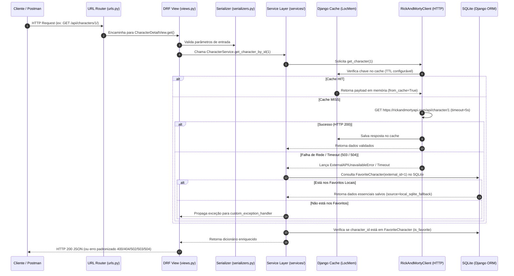

# Rick and Morty Explorer API (`rick-and-morty-explorer-api`)

API RESTful de portfólio construída com **Python**, **Django**, **Django REST Framework (DRF)**, **Pandas**, **SQLite** e **Docker**. A aplicação consome a [API Pública Oficial de Rick and Morty](https://rickandmortyapi.com/documentation) como fonte de leitura, adiciona **cache configurável**, **tratamento resiliente de falhas**, **persistência local de favoritos em SQLite com fallback offline** e um **motor de análise estatística com Pandas**.

---

## Sumário

1. [Stack Tecnológica](#-stack-tecnológica)
2. [Análise da Documentação Oficial da API Pública](#-análise-da-documentação-oficial-da-api-pública)
3. [Arquitetura e Caminho de uma Requisição](#-arquitetura-e-caminho-de-uma-requisição)
4. [Decisão Arquitetural REST: GET vs POST vs PUT no Endpoint de Estatísticas](#-decisão-arquitetural-rest-get-vs-post-vs-put-no-endpoint-de-estatísticas)
5. [Funcionalidades e Endpoints da API](#-funcionalidades-e-endpoints-da-api)
6. [Como Executar o Projeto (Localmente e com Docker)](#-como-executar-o-projeto-localmente-e-com-docker)
7. [Guia Completo do Postman (`publicbaseurl` e `localbaseurl`)](#-guia-completo-do-postman-publicbaseurl-e-localbaseurl)
8. [Testes Automatizados (Sem Dependência Externa)](#-testes-automatizados-sem-dependência-externa)

---

## Stack Tecnológica

| Tecnologia | Versão Compatível | Papel no Projeto |
| :--- | :--- | :--- |
| **Python** | `>=3.11` (Testado em `3.14.3` e `3.12`) | Linguagem base da aplicação |
| **Django** | `>=5.1,<7.0` | Framework web, ORM e sistema de cache |
| **Django REST Framework** | `>=3.15,<4.0` | Construção da API RESTful, Serializers e Views |
| **Pandas** | `>=2.2,<4.0` | Processamento tabular e cálculo estatístico dos favoritos |
| **SQLite + Django ORM** | Nativo | Persistência relacional local para personagens e episódios favoritos |
| **Requests** | `>=2.31,<3.0` | Cliente HTTP para comunicação com a API externa |
| **drf-spectacular** | `>=0.27,<1.0` | Geração automática da documentação OpenAPI 3 / Swagger UI / Redoc |
| **Docker & Docker Compose** | `v29+` / Compose `v2+` | Containerização e orquestração do ambiente |
| **Postman** | Collection v2.1 | Coleção estruturada para validação dos fluxos públicos e locais |

---

## Análise da Documentação Oficial da API Pública

A API oficial (`https://rickandmortyapi.com/api`) é uma API REST/GraphQL pública e gratuita (sem necessidade de autenticação) que expõe três recursos principais:

1. **Characters (`/character`)**:
   - **Paginação**: Retorna até **20 personagens por página**, acompanhados do objeto `info` (`count`, `pages`, `next`, `prev`) e da lista `results`.
   - **Filtros suportados via Query Params**:
     - `page`: Número da página (`?page=2`).
     - `name`: Filtra pelo nome do personagem (`?name=rick`).
     - `status`: Filtra pelo status de vida (`alive`, `dead` ou `unknown`).
     - `species`: Filtra pela espécie (`Human`, `Alien`, etc.).
     - `type`: Filtra pelo subtipo/subespécie.
     - `gender`: Filtra pelo gênero (`female`, `male`, `genderless` ou `unknown`).
   - **Campos retornados por personagem**: `id`, `name`, `status`, `species`, `type`, `gender`, `origin` (`name`, `url`), `location` (`name`, `url`), `image`, `episode` (lista de URLs dos episódios), `url` e `created`.
2. **Episodes (`/episode`)**:
   - Permite buscar episódios por ID (`/episode/{id}`) ou filtrar por `name` e código `episode` (ex: `S01E01`).
   - Campos principais: `id`, `name`, `air_date`, `episode`, `characters`, `url`, `created`.
3. **Locations (`/location`)**:
   - Permite consultar planetas e dimensões com filtros `name`, `type` e `dimension`.

---

## Arquitetura e Caminho de uma Requisição

O projeto foi desenhado aplicando **Separação de Responsabilidades (Separation of Concerns)** em camadas bem definidas:

```text
rick-and-morty-explorer-api/
├── config/                     # Configurações globais do Django, URLs raiz e WSGI/ASGI
├── explorer/                   # Aplicação principal
│   ├── clients/
│   │   └── rick_and_morty.py   # Camada de Integração HTTP externa + Cache + Tratamento de Erros de Rede
│   ├── services/
│   │   ├── character_service.py # Regras de negócio de personagens e Fallback Local (SQLite)
│   │   ├── favorite_service.py  # Regras de negócio e persistência de favoritos (Personagens e Episódios)
│   │   └── stats_service.py     # Motor de análise estatística utilizando DataFrames do Pandas
│   ├── models.py               # Modelos do Django ORM (FavoriteCharacter e FavoriteEpisode)
│   ├── serializers.py          # Validação de entrada/saída e contratos OpenAPI
│   ├── views.py                # Camada HTTP (DRF APIViews enxutas)
│   ├── exception_handler.py    # Padronização global de respostas de erro JSON
│   ├── exceptions.py           # Exceções de domínio e de integração (400, 404, 502, 503, 504)
│   └── tests/                  # Testes unitários e de integração com mocks (sem rede externa)
├── postman/                    # Coleção e Environment do Postman
├── Dockerfile
├── docker-compose.yml
├── requirements.txt
└── pyproject.toml
```

### Fluxograma do Caminho de uma Requisição



### Passo a Passo Detalhado do Ciclo de Vida

1. **Roteamento (`config/urls.py` -> `explorer/urls.py`)**: A requisição HTTP chega ao Django e é direcionada para a `APIView` correspondente.
2. **Validação de Entrada (`explorer/serializers.py`)**: Na camada de `View`, os parâmetros de query (`page`, `name`, `status`, `species`, `gender`) ou o corpo JSON (`character_id`, `episode_id`) são validados por um `Serializer`. Caso haja erro (ex.: `status=imortal`), o DRF interrompe imediatamente o fluxo e retorna `HTTP 400 Bad Request`.
3. **Orquestração de Negócio (`explorer/services/`)**: A `View` não contém lógica de negócio nem faz chamadas HTTP/ORM diretas; ela delega para `CharacterService`, `FavoriteService` ou `StatsService`.
4. **Cliente HTTP Isolado e Cache (`explorer/clients/rick_and_morty.py`)**:
   - Quando é necessário consultar a API pública, o `RickAndMortyClient` gera uma chave determinística MD5 para o endpoint e parâmetros e consulta o cache do Django (`CACHE_TTL_SECONDS`).
   - Em caso de *cache miss*, realiza a requisição `GET` com `timeout` configurável (`RICK_AND_MORTY_API_TIMEOUT`).
   - Valida o status HTTP e a integridade do schema JSON retornado. Qualquer anomalia é convertida em exceções de domínio claras (`ExternalResourceNotFoundError` -> `404`, `ExternalAPIUnexpectedResponseError` -> `502`, `ExternalAPIUnavailableError` -> `503`, `ExternalAPITimeoutError` -> `504`).
5. **Persistência Local e Fallback Resiliente (`explorer/models.py` / SQLite)**:
   - Ao favoritar um personagem (`POST /api/favorites/`), todos os seus **dados essenciais** (`external_id`, `name`, `status`, `species`, `type`, `gender`, `origin_name`, `location_name`, `image`, `episode_urls`, `episode_count`) são persistidos no SQLite.
   - Se a API pública ficar indisponível, tanto a listagem de favoritos (`GET /api/favorites/`) quanto a consulta individual do personagem (`GET /api/characters/{id}/`) continuam funcionando normalmente usando os dados locais do SQLite (`source: "local_sqlite_fallback"`).
6. **Análise Estatística com Pandas (`explorer/services/stats_service.py`)**:
   - No endpoint `/api/favorites/stats/`, os registros do SQLite são carregados em um `pandas.DataFrame`, onde são calculadas distribuições absolutas e percentuais (`value_counts`), medidas de tendência central de participação em episódios (`mean`, `median`, `min`, `max`, `sum`) e tabulação cruzada (`pd.crosstab`) de espécie por status.
7. **Tratamento Global de Exceções (`explorer/exception_handler.py`)**:
   - Qualquer exceção de domínio ou de validação é interceptada pelo `custom_exception_handler`, garantindo que todos os erros da API sigam o mesmo contrato JSON (`error`, `code`, `message`, `status_code`, `details`).

---

## Decisão Arquitetural REST: `GET` vs `POST` vs `PUT` no Endpoint de Estatísticas

Uma dúvida muito comum ao desenhar endpoints analíticos como `/api/favorites/stats/` é qual verbo HTTP utilizar:

- **Por que `GET` é o método principal recomendado pelo padrão REST?**
  No protocolo HTTP e na arquitetura REST, o método **`GET`** deve ser utilizado para qualquer operação que **apenas lê ou calcula uma representação derivada do estado atual do servidor sem modificá-lo** (*Safe & Idempotent Method*). Mesmo que o servidor execute processamento pesado em memória com **Pandas** (agregações, médias, cruzamentos), nenhum recurso novo está sendo persistido no banco de dados. Usar `GET /api/favorites/stats/` permite cacheamento HTTP, compartilhamento de URL com query params (`?status=Alive`) e semântica RESTful limpa.
- **Quando `POST` é utilizado?**
  O método **`POST`** é usado primariamente para **criar recursos** (como `POST /api/favorites/`) ou quando o cliente precisa enviar um **payload complexo de parâmetros/filtros ou conjunto de dados no corpo (body) da requisição** para processamento sob demanda.
  - **Na nossa API, suportamos AMBOS os métodos em `/api/favorites/stats/`**:
    - `GET /api/favorites/stats/`: Calcula e retorna todas as estatísticas dos favoritos no SQLite com Pandas (aceitando filtros opcionais via query string).
    - `POST /api/favorites/stats/`: Permite enviar filtros no corpo JSON (ex.: `{"status": "Alive", "species": "Human"}`) para calcular estatísticas segmentadas com Pandas.
- **Por que NÃO usar `PUT`?**
  O método **`PUT`** tem semântica estrita de **substituição completa e idempotente** de um recurso existente em uma URI específica (por exemplo, substituir todos os campos de um registro já salvo). Como o endpoint de estatísticas não substitui o estado de nenhum recurso no banco, `PUT` seria semanticamente incorreto.

---

## Funcionalidades e Endpoints da API

### Documentação Interativa (OpenAPI 3 / Swagger)

Com o servidor rodando, acesse no navegador:
- **Swagger UI**: `http://localhost:8000/api/docs/`
- **Redoc**: `http://localhost:8000/api/redoc/`
- **Schema OpenAPI (YAML/JSON)**: `http://localhost:8000/api/schema/`

### Tabela de Endpoints

| Método | Endpoint | Descrição |
| :--- | :--- | :--- |
| `GET` | `/api/health/` | Verifica saúde da API, URL base externa e configuração de cache |
| `GET` | `/api/characters/` | Lista personagens da API pública respeitando paginação (`?page=`) e filtros (`?name=`, `?status=`, `?species=`, `?gender=`, `?type=`) |
| `GET` | `/api/characters/{id}/` | Busca personagem pelo ID (com **fallback automático para o SQLite** se a API pública estiver fora do ar e o personagem for favorito) |
| `GET` | `/api/favorites/` | Lista todos os personagens favoritos salvos localmente no SQLite |
| `POST` | `/api/favorites/` | Adiciona um personagem aos favoritos no SQLite salvando seus dados essenciais (`{"character_id": 1, "notes": "..."}`) |
| `GET` | `/api/favorites/{id}/` | Consulta os dados locais de um favorito específico no SQLite |
| `DELETE` | `/api/favorites/{id}/` | Remove um personagem dos favoritos no SQLite |
| `GET` | `/api/favorites/episodes/` | Lista os episódios favoritos salvos no SQLite e o ranking de episódios dos personagens favoritos |
| `POST` | `/api/favorites/episodes/` | Salva um episódio favorito no SQLite (`{"episode_id": 1, "notes": "..."}`) |
| `DELETE` | `/api/favorites/episodes/{id}/` | Remove um episódio favorito do SQLite |
| `GET` / `POST` | `/api/favorites/stats/` | Calcula estatísticas analíticas completas dos favoritos usando **Pandas** |

---

## Como Executar o Projeto (Localmente e com Docker)

### Opção 1: Execução Local (Python + Virtualenv)

1. **Clone o repositório e acesse a pasta do projeto**:
   ```bash
   git clone https://github.com/MatheusLeo26/rick-and-morty-explorer-api.git
   cd rick-and-morty-explorer-api
   ```

2. **Crie e ative o ambiente virtual (`venv`)**:
   - **Windows (PowerShell)**:
     ```powershell
     python -m venv .venv
     .\.venv\Scripts\Activate.ps1
     ```
   - **Linux / macOS**:
     ```bash
     python3 -m venv .venv
     source .venv/bin/activate
     ```

3. **Instale as dependências**:
   ```bash
   pip install -r requirements.txt
   ```

4. **Configure as variáveis de ambiente**:
   Copie o arquivo `.env.example` para `.env`:
   ```bash
   cp .env.example .env
   ```

5. **Execute as migrações do banco SQLite e inicie o servidor**:
   ```bash
   python manage.py migrate
   python manage.py runserver 0.0.0.0:8000
   ```
   A API estará disponível em `http://localhost:8000/api/` e o Swagger em `http://localhost:8000/api/docs/`.

---

### Opção 2: Execução com Docker e Docker Compose

1. **Construa e suba o container**:
   ```bash
   docker-compose up --build
   ```
   *(Ou `docker compose up --build` conforme a versão do seu Docker CLI).*

2. O container executará automaticamente `python manage.py migrate --noinput` e iniciará o servidor `gunicorn` na porta `8000`, persistindo o banco SQLite no volume `sqlite_data`.

3. Para parar os containers:
   ```bash
   docker-compose down
   ```

---

## Guia Completo do Postman (`publicbaseurl` e `localbaseurl`)

A coleção oficial do projeto encontra-se na pasta [`postman/`](./postman/):
- **Coleção**: [`postman/rick-and-morty-explorer-api.postman_collection.json`](./postman/rick-and-morty-explorer-api.postman_collection.json)
- **Ambiente (Environment)**: [`postman/rick-and-morty-explorer-api.postman_environment.json`](./postman/rick-and-morty-explorer-api.postman_environment.json)

### 1. Como Importar a Coleção no Postman

1. Abra o **Postman**.
2. Clique no botão **Import** (canto superior esquerdo).
3. Arraste e solte os arquivos `postman/rick-and-morty-explorer-api.postman_collection.json` e `postman/rick-and-morty-explorer-api.postman_environment.json`.
4. No seletor de ambientes (canto superior direito do Postman), selecione **"Rick and Morty Explorer - Local Environment"**.

### 2. Como Configurar as Variáveis (`publicbaseurl` e `localbaseurl`)

Tanto a coleção quanto o environment já vêm pré-configurados com as duas variáveis exigidas:

| Variável | Valor Padrão | Descrição |
| :--- | :--- | :--- |
| `publicbaseurl` | `https://rickandmortyapi.com/api` | URL base oficial da API pública de Rick and Morty |
| `localbaseurl` | `http://localhost:8000` | URL base da nossa API local (`rick-and-morty-explorer-api`) |

Caso sua API local esteja rodando em outra porta, basta clicar na aba **Variables** da coleção (ou no ícone de olho do Environment) e alterar `localbaseurl`.

### 3. Como Executar Cada Fluxo na Coleção

A coleção está organizada em **duas pastas**:

#### Pasta 1: `1. API Publica` (Usa `{{publicbaseurl}}`)
1. **Listar Personagens (Paginado)**: Envia `GET {{publicbaseurl}}/character?page=1` para inspecionar a paginação original de 20 itens da API pública.
2. **Buscar Personagem por ID**: Envia `GET {{publicbaseurl}}/character/1` para visualizar o payload bruto do Rick Sanchez.
3. **Filtrar Personagens**: Envia `GET {{publicbaseurl}}/character/?name=rick&status=alive&species=Human`.
4. **Listar Episódios da API Pública**: Envia `GET {{publicbaseurl}}/episode?page=1`.
5. **Exemplo de Erro 404 na API Pública**: Envia `GET {{publicbaseurl}}/character/999999`.

#### Pasta 2: `2. Minha API (Rick and Morty Explorer)` (Usa `{{localbaseurl}}`)
Execute as requisições na seguinte ordem recomendada para testar todo o ciclo de vida:
1. **Healthcheck da API** (`GET {{localbaseurl}}/api/health/`): Confirma que o servidor local está online.
2. **Listar Personagens (Paginado + Cache)** (`GET {{localbaseurl}}/api/characters/?page=1`): Na primeira execução retorna `"from_cache": false`; ao clicar em **Send** novamente dentro do tempo de expiração (`CACHE_TTL_SECONDS`), retorna `"from_cache": true` instantaneamente!
3. **Filtrar Personagens por Nome, Status e Espécie** (`GET {{localbaseurl}}/api/characters/?name=rick&status=alive&species=Human&page=1`).
4. **Buscar Personagem pelo ID** (`GET {{localbaseurl}}/api/characters/1/`).
5. **Adicionar um Favorito (Rick Sanchez #1)** (`POST {{localbaseurl}}/api/favorites/`): Salva Rick Sanchez e seus dados essenciais no SQLite (`201 Created`).
6. **Adicionar um Favorito (Morty Smith #2)** (`POST {{localbaseurl}}/api/favorites/`): Salva Morty Smith no SQLite (`201 Created`).
7. **Listar Favoritos (SQLite)** (`GET {{localbaseurl}}/api/favorites/`): Retorna os favoritos diretamente do banco SQLite local.
8. **Adicionar e Listar Episódios Favoritos no SQLite** (`POST` e `GET {{localbaseurl}}/api/favorites/episodes/`): Persiste episódios favoritos no SQLite e exibe também a contagem de episódios em que seus personagens favoritos aparecem.
9. **Consultar Stats dos Favoritos (Pandas - GET e POST)** (`{{localbaseurl}}/api/favorites/stats/`): Retorna o relatório analítico gerado pelo **Pandas** (totais, percentuais por status, distribuição por espécie/gênero, médias/medianas de episódios e matriz cruzada `species_by_status`).
10. **Remover Favorito (#2)** (`DELETE {{localbaseurl}}/api/favorites/2/`): Remove o favorito do SQLite.
11. **Exemplos de Erros Padronizados**:
    - `GET {{localbaseurl}}/api/characters/999999/` -> `404 Not Found` (`resource_not_found`)
    - `GET {{localbaseurl}}/api/characters/?status=imortal` -> `400 Bad Request` (`validation_or_request_error`)
    - `POST {{localbaseurl}}/api/favorites/` com ID já existente -> `400 Bad Request` (`duplicate_favorite`)
    - `DELETE {{localbaseurl}}/api/favorites/999999/` -> `404 Not Found` (`resource_not_found`)

---

## Testes Automatizados (Sem Dependência Externa)

A suíte conta com **21 testes automatizados** divididos em:
- `explorer/tests/test_client.py`: Testa o cliente HTTP isolado (`RickAndMortyClient`), cache hit/miss, paginação, filtros, timeout (`504`), indisponibilidade (`503`), 404 (`ExternalResourceNotFoundError`) e respostas malformadas (`502`).
- `explorer/tests/test_services.py`: Testa as regras de negócio (`CharacterService`, `FavoriteService`), o **fallback automático para o SQLite quando a API pública está indisponível** e os cálculos estatísticos com `pandas.DataFrame` (`StatsService`).
- `explorer/tests/test_views.py`: Testa todos os endpoints REST e a geração do schema OpenAPI/Swagger usando `unittest.mock.patch`, **sem realizar nenhuma chamada real à internet**.

Para executar os testes:
```bash
python manage.py test --verbosity 2
```
